# QuantumScope User Guide

Written for **QuantumScope 0.8.0** · Quantum Visualization Studio · MIT licensed

QuantumScope is an interactive studio for learning quantum physics and quantum computing: hydrogen orbitals, the experiments behind quantum mechanics, quantum circuits and quantum machine learning, with built-in lessons that connect them. This guide shows how to use every part of it. To learn the physics itself, open **📖 Learn** inside the app.

## 1. Installing and updating

QuantumScope runs on **Windows** (64-bit), **macOS** (Apple Silicon) and **Ubuntu or Debian Linux** (64-bit). Download the installer for your system from the project's **Releases** page on GitHub (github.com/Onimee58/QuantumScope):

| System | File | How to install |
|---|---|---|
| Windows | QuantumScope-…-Setup.exe | Run it and follow the steps. |
| macOS | QuantumScope-…-macOS.dmg | Open it and drag QuantumScope into Applications. |
| Ubuntu / Debian | quantumscope_…_amd64.deb | sudo apt install ./quantumscope_…_amd64.deb |

**First launch.** The installers are not code-signed yet, so your system may warn you once:

- **Windows:** if SmartScreen appears, choose **More info → Run anyway**.
- **macOS:** if the app is blocked, open **System Settings → Privacy & Security** and choose **Open Anyway**.

**Updating.** Open **ⓘ** (top right) and choose **Check for updates…**, or use **⚙ → Updates**. QuantumScope asks before it connects to GitHub. If a newer version exists, it shows the release notes; **Update now** downloads the installer, checks it against its published SHA-256 checksum, and installs it:

- **Windows:** the installer takes over, and QuantumScope closes.
- **Ubuntu:** enter your password when asked; QuantumScope waits for the installation and offers **Restart now**.
- **macOS:** the disk image opens; drag QuantumScope into Applications again.

Nothing is downloaded or installed without your confirmation, and a download that does not match its checksum is never installed.

## 2. A tour of the window

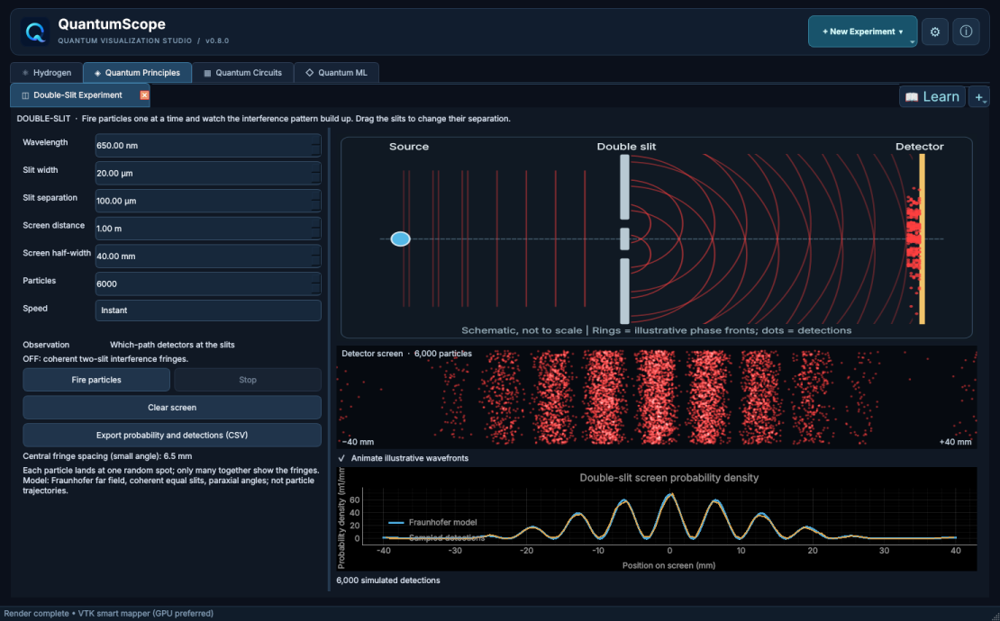

- **Areas:** the four tabs under the title, **Hydrogen**, **Quantum Principles**, **Quantum Circuits** and **Quantum ML**, are the four areas of the app.
- **Experiment tabs:** each area holds experiment tabs. Open more with **+** on the right of the tab bar, or with **+ New Experiment** at the top. Every tab can be closed with its **×**. A closed tab is only hidden, so opening it again brings it back exactly as you left it. An area with no open tabs shows a **Start** page with its experiments as buttons.
- **📖 Learn** opens the lessons for the current area (chapter 7).
- **⚙** opens **Settings** (chapter 8). **ⓘ** shows **About QuantumScope**, including **Check for updates…** and **User guide**, which opens this document.

When QuantumScope starts, its logo appears for a moment while the 3-D libraries load.

## 3. Hydrogen

The **Hydrogen Explorer** draws the hydrogen atom's orbitals in 3-D, exactly solved for the Schrödinger equation (with the proton's finite mass).

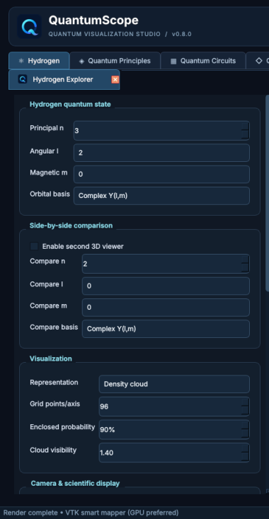

**Choosing a state.** Under **Hydrogen quantum state**, set **Principal n**, **Angular l** and **Magnetic m**. **Orbital basis** chooses between the complex orbitals **Y(l,m)** and the **Real cosine** or **Real sine** combinations (the familiar px, dxy shapes). Press **Render state** to draw it; with **Update when changing state/mode** ticked, it redraws by itself.

**How it is drawn.** Under **Visualization**:

- **Representation:** **Density cloud** (a glowing cloud), **Probability enclosure** (a surface containing a chosen share of the probability), **Real(psi)** or **Imag(psi)**.
- **Enclosed probability** sets that share for the enclosure, for example 90%.
- **Grid points/axis** trades detail for speed, and **Cloud visibility** adjusts the cloud's brightness.
- **Color enclosure by wavefunction phase** colours the surface by the phase of ψ.

**The view.** Drag in the 3-D view to turn it, and scroll to zoom. Under **Camera & scientific display**, **View** jumps to **Perspective**, **+X**, **+Y** or **+Z**, and **Magnification** zooms. **Show axes and coordinates (a_mu)** adds axes in units of the (reduced-mass) Bohr radius. **Reset camera** returns to the start.

**Comparing two orbitals.** Tick **Enable second 3D viewer** under **Side-by-side comparison** and choose **Compare n**, **l**, **m** and **basis**. **Synchronize comparison cameras** keeps both views turned together.

**The radial chart** below the view shows P(r) = r²|Rnl(r)|², the probability of finding the electron at distance r.

**Exporting.** **Export PNG** saves the view (at the **PNG export scale**, 1–4×), and **Export grid (.npz)** saves the computed values for your own analysis.

### Hydrogen Dynamics 2D and 3D

Open these with **+** in the Hydrogen area. They show a superposition of two states, **State A** and **State B**, evolving in time: the cloud moves because the two energies differ (a **quantum beat**).

- **State A probability** and **Initial phase** set the mixture.
- **Time / beat period** moves through one beat; **Play** animates it.
- The 2-D version shows a **Cross-section plane**; the 3-D version shows the full cloud.
- **Exports:** a frame as PNG, a full period as an animated GIF (with **GIF frames / period** and **GIF frames per second**), and, in 2-D, the slice as NPZ data.

## 4. Quantum Principles

Four hands-on experiments on the ideas behind quantum mechanics. They share some controls:

- **Bloch spheres:** **left-drag** sets a state (or, in Entanglement, aims a detector). **Right-drag**, or **Shift + left-drag** on a trackpad, turns the sphere to look from any side, and **double-click** resets the view.
- **Speed:** experiments that repeat measurements offer **Slow**, **Fast** and **Instant**, with **Stop**.

### Double-Slit

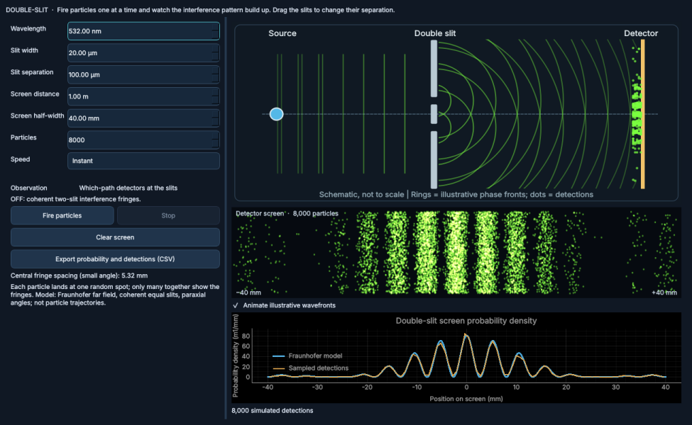

Particles pass through two slits and land on a screen. **Fire particles** sends them one after another: each lands as a single dot, and the interference fringes appear only as the dots pile up. The chart compares the detections with the exact pattern.

- **Wavelength** sets the light's colour; ultraviolet and infrared are shown in a labelled false colour.
- **Slit width**, **Slit separation**, **Screen distance** and **Screen half-width** set the geometry. You can also **drag the slits** in the drawing up or down to change their separation.
- **Which-path detectors at the slits** destroy the interference: the fringes give way to a single broad band.
- **Clear screen** starts again; **Export probability and detections (CSV)** saves the data.

### Superposition

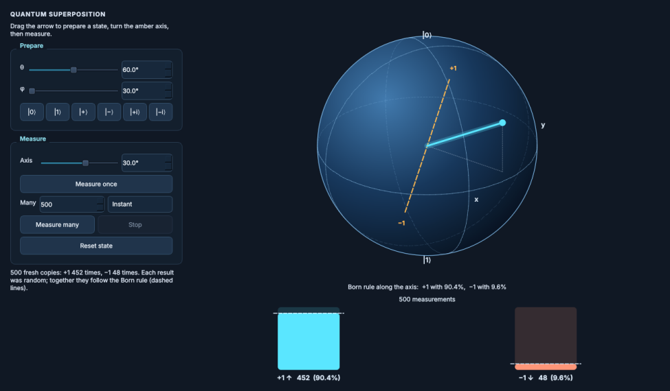

- **Prepare** a spin-½ state by **dragging the arrow**, with the **θ** and **φ** sliders, or with a preset: |0⟩, |1⟩, |+⟩, |−⟩, |+i⟩ or |−i⟩.
- **Measure:** **Axis** turns the amber measurement axis, whose ends are the results +1 and −1.
  - **Measure once:** the arrow jumps to +1 or −1 with a flash (the collapse). **Reset state** returns to the prepared state.
  - **Measure many:** fresh copies are measured one after another, and the bars grow toward the dashed **Born-rule** predictions.

### Entanglement

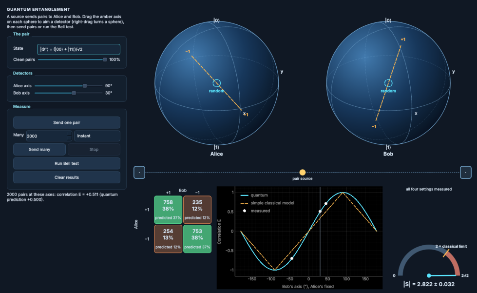

A source sends pairs of qubits to Alice and Bob.

- **The pair:** choose a Bell state, or a **classically correlated** pair for comparison. **Clean pairs** adds noise.
- **Each sphere shows that qubit's own state:** for an entangled pair, **random**, since neither qubit has a state of its own.
- **Aim the detectors** by dragging the amber axis on each sphere, or with the **Alice axis** and **Bob axis** sliders.
- **Send one pair** follows a single pair: Alice measures, both qubits become definite, then Bob measures. No signal travels: on his own, Bob's results stay random.
- **Send many** fills the **grid** of joint results and the **correlation curve**, which compares the measurements with the quantum prediction and a simple classical model.
- **Run Bell test** measures the four standard detector settings and shows **|S|** with its uncertainty on the meter. Entangled pairs beat the classical limit of 2, up to 2√2 ≈ 2.83; noisy or classical pairs do not.

### Teleportation

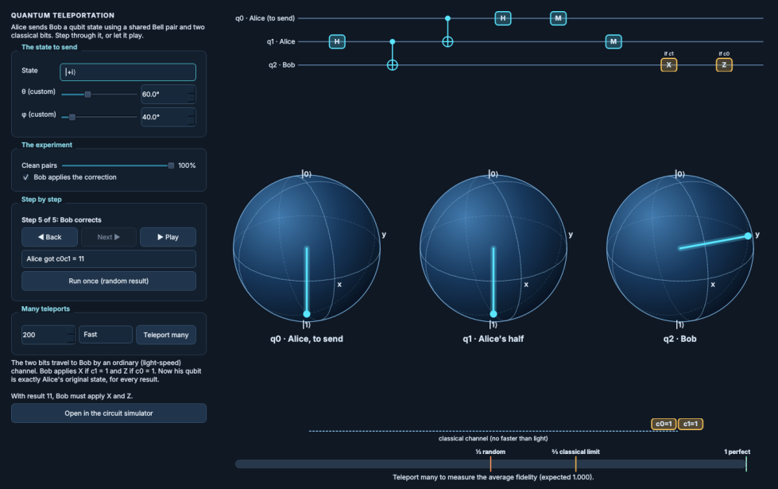

Alice sends Bob a qubit's state using a shared Bell pair and two classical bits.

- **The state to send:** a preset, or **Custom** with θ and φ; at step 1 you can also drag the arrow on q0.
- **Step by step:** **◀ Back**, **Next ▶**, or **▶ Play**. The circuit at the top highlights each step. When Alice measures, her two bits travel to Bob along the classical channel before he applies his correction.
- **The measurement result:** choose one of the four, keep "unknown to Bob" for the average, or **Run once (random result)**.
- **Experiments:**
  - **Clean pairs** adds noise to the shared pair, lowering the fidelity.
  - **Bob applies the correction** can be unticked, to see why the classical bits are needed.
- **Teleport many** measures the average fidelity over many runs, against ½ (random), ⅔ (the best possible without entanglement) and 1.
- **Open in the circuit simulator** loads the same protocol as a circuit.

## 5. Quantum Circuits

The **Gate Circuit Simulator** builds and simulates circuits of up to 10 qubits, exactly.

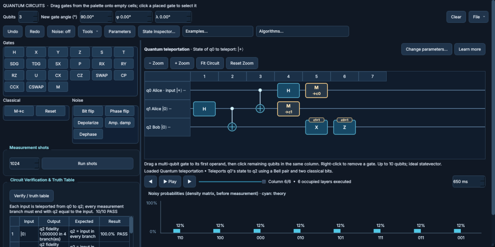

### Building a circuit

- **Qubits** sets the number of qubits. **New gate angle** sets the angle given to new rotation gates (with **φ** and **λ** for the U gate).
- **Placing gates:** drag a gate from the palette on the left onto an empty cell. For a gate on several qubits (**CX**, **CZ**, **SWAP**, **CP**, **CCX**, **CSWAP**), drop it on its first qubit, then click the other qubits in the same column.
- **Editing:** click a placed gate to select it. **Double-click** it to edit its angles (or a noise box's strength); double-clicking a grouped **block** expands it. **Right-click** removes a gate.
- **Qubit labels:** right-click a qubit's name on the left to give it a label, such as *data* or *Alice*.
- **Undo** and **Redo** step through changes. **Clear** empties the circuit.
- **Zooming:** **− Zoom** and **+ Zoom**, **Fit Circuit** and **Reset Zoom**.
- **The palette:**
  - **Gates:** H, X, Y, Z, S, T, SDG, TDG, SX, P, RX, RY, RZ, U, CX, CZ, SWAP, CP, CCX, CSWAP and M (a final measurement).
  - **Classical:** **M→c**, a measurement in the middle of the circuit into a classical bit, and **Reset**.
  - **Noise:** **Bit flip**, **Phase flip**, **Depolarize**, **Amp. damp** and **Dephase**, which can be placed like gates.
  - **Double-click** any gate or noise item in the palette for an explanation of what it does.

### Running and reading results

- **Playback:** **◀**, **▶ Play** and **▶** step through the circuit column by column; the probabilities and Bloch spheres show the state at that point.
- **Probabilities:** the chart shows each basis state's probability, with the theory in cyan. The line underneath lists them.
- **Measurement shots:** set the number of shots and press **Run shots** to sample results as an experiment would.
- **State Inspector…** opens a window with the **Amplitudes**, **Statevector**, **Reduced state** (each qubit's own state), **Circuit** statistics and, for circuits with mid-circuit measurements, **Branches**.

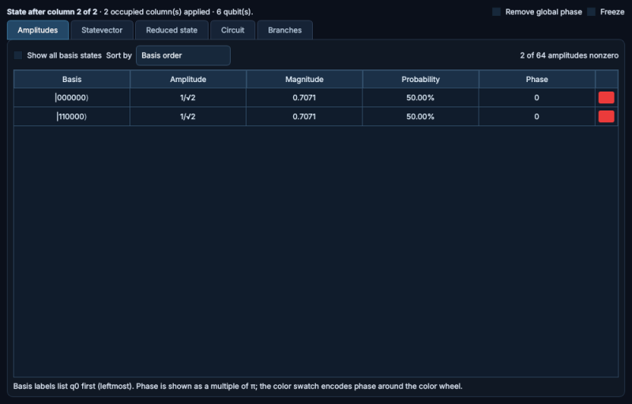

### Examples, algorithms and checking

- **Examples…** loads ready-made circuits: the Bell pair, GHZ, adders and comparators, teleportation, superdense coding, and the bit-flip, phase-flip and Shor codes.
- **Algorithms…** loads Deutsch, Deutsch–Jozsa, Bernstein–Vazirani, Grover search, the quantum Fourier transform, phase estimation, VQE, VQLS and QAOA. A bar above the circuit names the example; **Change parameters…** adjusts it, and **Learn more** opens its lesson.
- **Verify / truth table** checks the circuit against its specification: for an example, every required input; for your own circuit, a truth table of basis-state inputs.
- **Plot logical error rate** appears for error-correction examples, **Show the graph** for QAOA, and **Show the solution** for VQLS.
- **Noise: off** opens the noise settings: presets, error rates, idle noise and readout errors. With noise on, the simulation uses density matrices.

### Parameters and optimization

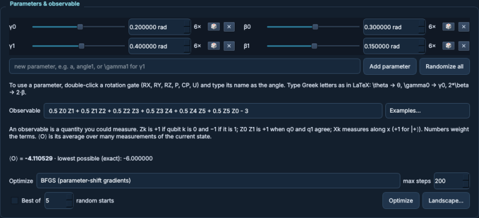

Press **Parameters** to show the panel.

- **Parameters:** add a name with **Add parameter** (type \theta for θ, \gamma0 for γ0). Then double-click a rotation gate and type the name, or a multiple like 2*\beta, as its angle.
  - **Sliders** change parameters live. On wide windows they show in two columns.
  - **🎲** randomizes one parameter, and **Randomize all** randomizes every one.
- **Observable:** type a weighted sum of Pauli terms, such as Z0 Z1 + 0.5 X0, or pick one from **Examples…**. The panel shows its expectation value ⟨O⟩ and the lowest possible value.
- **Optimize** lowers ⟨O⟩ with the chosen method (**BFGS**, **Gradient descent**, **COBYLA** or **Nelder–Mead**). **Best of N random starts** also tries random starting points and keeps the best.
- **Landscape…** draws ⟨O⟩ over two parameters, with the optimizer's path.

### Solving linear systems (VQLS)

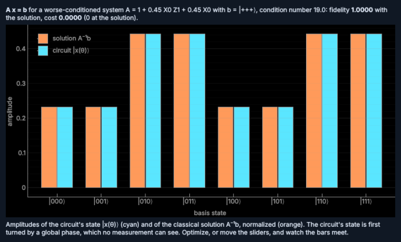

**Algorithms… → Variational quantum linear solver** prepares a state proportional to the solution of A x = b. Choose the standard 3-qubit system, a worse-conditioned one, a 1-qubit one, or **Your own system**: A as a sum of Pauli terms on 1 to 3 qubits (it must be invertible) and b as |0…0⟩, |+…+⟩ or |1…1⟩. The observable is the VQLS cost, which is 0 exactly at the solution. Press **Optimize**, then **Verify / truth table**: the check passes at a fidelity of at least 0.99 with the classical solution. **Show the solution** compares the amplitudes as you go.

### Files and tools

- **File:** **Open .qscope…**, **Open recent**, **Save .qscope…**, **Import OpenQASM 2…**, **Export OpenQASM 2…** and **Export PDF…** (the circuit diagram, optionally with a probability report).
- **Tools:** **Simplify circuit…** and **Check equivalence with a saved circuit…**.
- **The QASM Converter** (open it with **+**) converts between OpenQASM 2 and QuantumScope's .qscope format.
- **The Error-correction explorer** (open it with **+**) compares how the error-correcting codes perform as noise grows.
- **Autosave:** QuantumScope saves your circuit as you work and offers to recover it after a crash (see **⚙ → Files**).

## 6. Quantum ML

The **Quantum ML** area turns data into quantum states and learns from them. Its three experiments open from **+**: **Datasets**, **Quantum Kernel Classifier** and **Variational Classifier**. Everything runs offline; the five built-in datasets are part of the app.

### Datasets

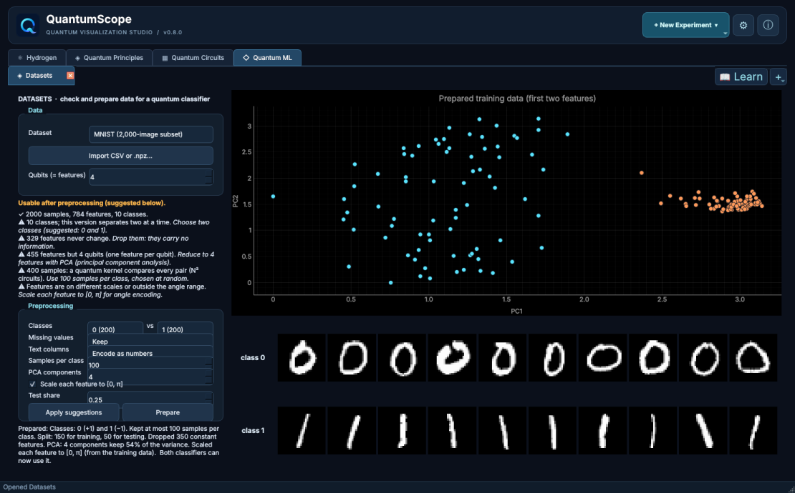

- **Dataset** picks a built-in dataset (Iris, Wine, Breast Cancer Wisconsin, Digits 8×8 and a 2,000-image MNIST subset) or a synthetic one (moons, circles, XOR, blobs). **Import CSV or .npz…** reads your own data: a CSV with a label column (named label, target, class … or the last column), or a NumPy file with arrays named X and y.
- **Qubits (= features)** is how many features the prepared data will have: each classifier encodes one feature per qubit.
- **The checker** gives a verdict (ready, usable after preprocessing, or cannot be used) and lists what stands in the way, each with a suggested fix: too many features, too many samples, more than two classes, text columns, missing values, or features on different scales.
- **Preprocessing** shows every step and lets you change it: **Classes**, **Missing values**, **Text columns**, **Samples per class**, **PCA components**, scaling to [0, π] and the **Test share**. **Apply suggestions** restores the checker's recipe, and **Prepare** prepares the data and shares it with both classifiers.
- The data is split into training and test sets first, and every learned step (means, PCA, scaling) is fitted on the training part only, so the test accuracy is honest.
- The plot shows the prepared training data; for Digits and MNIST, example images of the two chosen classes appear below it.

### Quantum Kernel Classifier

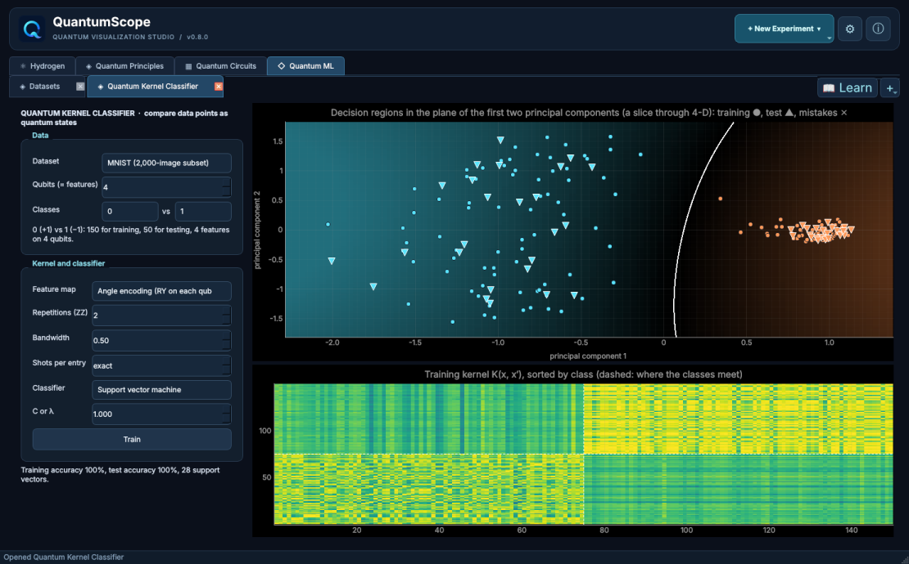

- **Data:** choose **From the Datasets tab**, or any dataset directly; it is then prepared with the checker's suggested recipe. For a dataset with more than two classes, **Classes** chooses the pair to separate.
- **Feature map:** **Angle encoding** (RY on each qubit) or the entangling **ZZ feature map**, with its **Repetitions**. **Bandwidth** scales the data before encoding: smaller values make the kernel smoother.
- **Shots per entry** estimates each kernel value from that many shots, as a quantum computer would; **exact** computes it exactly.
- **Classifier:** a **Support vector machine** or **Kernel ridge**, with its strength **C or λ**. **Train** builds the kernel and the classifier.
- **The decision regions** show the predicted class behind the points, deeper where the classifier is more confident, with the boundary as a white line. Training points are dots, test points triangles, and mistakes are marked ✕. With more than two features, the regions are drawn in the plane of the two leading principal components, a slice through the data.
- **The kernel heatmap** shows the training kernel sorted by class. If the kernel is close to 0 for different points (kernel concentration), the result says so and suggests a smaller bandwidth.

### Variational Classifier

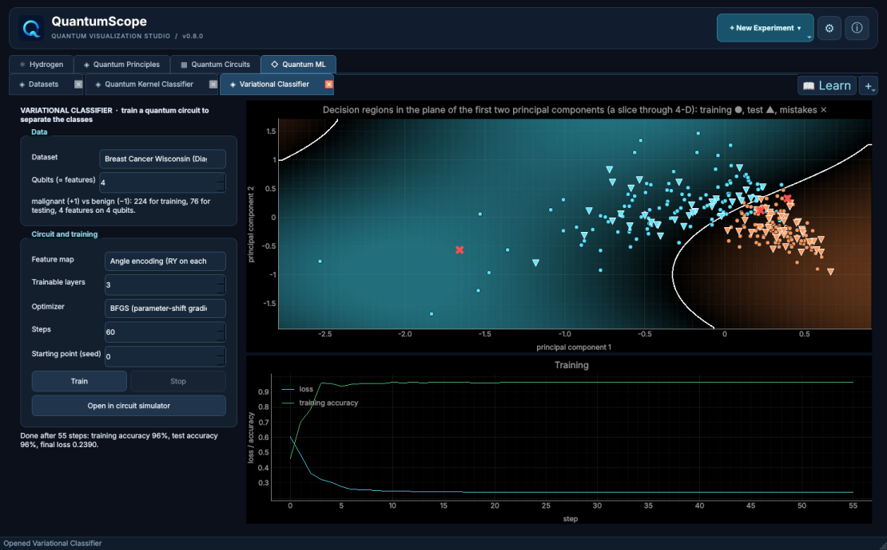

- The circuit is the feature map followed by **Trainable layers** of RY gates and CNOTs; its output is ⟨Z₀⟩ plus a bias.
- **Optimizer:** **BFGS**, with exact parameter-shift gradients, or **Adam**. Set the **Steps** and the **Starting point (seed)**.
- **Train** shows the loss and the training accuracy step by step, and the decision regions as they change; **Stop** ends training early.
- **Open in circuit simulator** loads the trained circuit for one test point into Quantum Circuits, with the observable Z0.

## 7. Learn

**📖 Learn** opens QuantumScope's course: lectures and labs for every area, plus **Mathematics**.

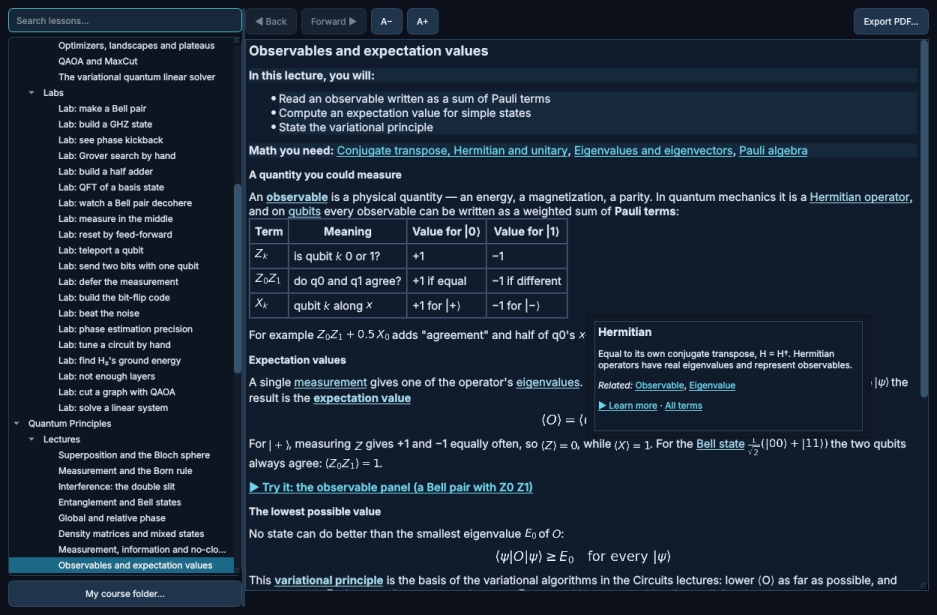

- **Contents:** lessons are grouped by area: **Quantum Circuits**, **Quantum Principles**, **Hydrogen**, **Mathematics** and **Quantum ML**. **Search lessons…** finds any lesson by its words.
- **Lectures** explain a topic. **Math you need** at the top links to the Mathematics lessons it builds on.
- **Try it** links open the matching experiment or circuit in the main window.
- **Quizzes** check your understanding: click an answer to see whether it is right, and why.
- **Labs** give step-by-step tasks in the circuit simulator or the Quantum ML experiments, and check each step as you complete it.
- **The glossary:** underlined terms, such as *Hermitian*, show a short definition when clicked, with related terms and **Learn more**. **Glossary** in the contents lists all of them.
- **Reading:** **◀ Back** and **Forward ▶** move through the lessons you have visited, and **A−** and **A+** change the text size.
- **Export PDF…** saves the lesson as a handout, ending with the terms it uses.

**For teachers: My course.** **My course folder…** adds your own lessons and labs, written in the same simple format. They appear under **My course**, with glossary links and **Math you need** like the built-in ones. The file LEARN.md in the project describes the format.

## 8. Settings

**⚙** opens **Settings**. Changes apply at once, except where noted; **Restart now** restarts when needed, and **Restore defaults** resets everything (your recent files are kept).

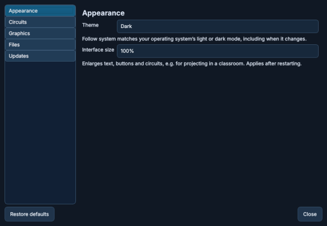

- **Appearance:** **Theme** (**Dark**, **Light** or **Follow system**) and **Interface size** (100–175%, useful for projecting in a classroom; applies after a restart).
- **Circuits:** defaults for new circuits:
  - **Qubits in a new circuit** and **Measurement shots**;
  - **Gate angles** in degrees or radians, and **Bit order in labels**, q0 leftmost (textbook) or rightmost (Qiskit);
  - **Amplitudes** shown exactly (1/√2) or as decimals, with **Decimal places**;
  - **Ask before clearing a circuit**.
- **Graphics:** **Graphics device** (**Automatic**, **Integrated graphics**, or **NVIDIA (PRIME offloading)** on Linux laptops with two GPUs; applies after a restart) and **3D volume rendering** (**Auto**, **GPU** or **CPU**). **Refresh** shows which graphics renderer is in use.
- **Files:**
  - **Save and export to:** the default folder (**Browse…** or **Use Documents**);
  - **Autosave**;
  - **Probability report in PDF exports:** ask each time, always, or never;
  - **Recent circuits**, with **Clear recent list**.
- **Updates:** the current version and **Check for updates…**.

## 9. Troubleshooting

**The 3-D view is blank, black or very slow.** Open **⚙ → Graphics**. Try **3D volume rendering: CPU**, which works on any computer. On a laptop with two graphics chips, try the other **Graphics device**, then restart. **Refresh** shows which renderer is actually in use; include it if you report a problem.

**Everything is too small on a projector or a high-resolution screen.** Set **⚙ → Appearance → Interface size** to 125–175% and restart.

**Basis states are written in the opposite order to my textbook.** Change **⚙ → Circuits → Bit order in labels**. Only the labels change; the physics is identical.

**QuantumScope closed unexpectedly.** When it starts again, it offers to recover your autosaved circuit.

**Check for updates says it cannot connect.** Check your internet connection and try again later. GitHub also limits how often it can be asked, so wait a while if you have checked many times. You can always download the latest release from the Releases page.

**Reporting a problem.** Open an issue on GitHub (github.com/Onimee58/QuantumScope). Describe what you did, what happened, your system, and the version shown in **ⓘ**.

## 10. Mouse and keyboard reference

| Where | Action | Result |
|---|---|---|
| Circuit | drag from the palette | place a gate |
| Circuit | click a gate / double-click it | select it / edit its angles |
| Circuit | right-click a qubit's name | give the qubit a label |
| Circuit | right-click a gate | remove it |
| Circuit | click other qubits after dropping a multi-qubit gate | choose its other qubits |
| Palette | double-click a gate or noise item | explain it |
| Bloch sphere | left-drag | set the state (Entanglement: aim the detector) |
| Bloch sphere | right-drag, or Shift + left-drag | turn the sphere |
| Bloch sphere | double-click | reset the view |
| Double-Slit | drag the slits | change their separation |
| Hydrogen 3-D view | drag / scroll | turn / zoom |
| Learn | click an underlined term | show its definition |
| Any tab | × on the tab | close it (it reopens as you left it) |

QuantumScope is open-source software (MIT licence) by Md. Saif Hassan Onim, Southern Methodist University. Its simulations are idealized for teaching.
